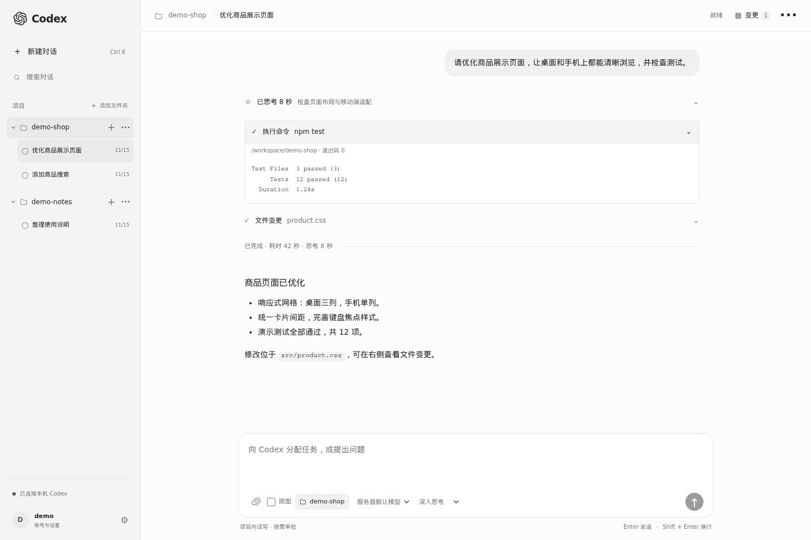
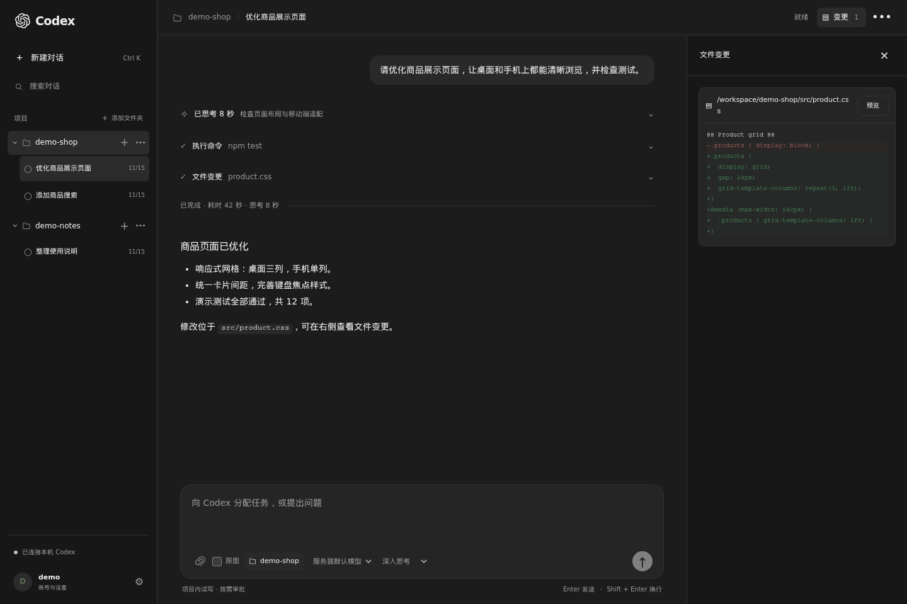
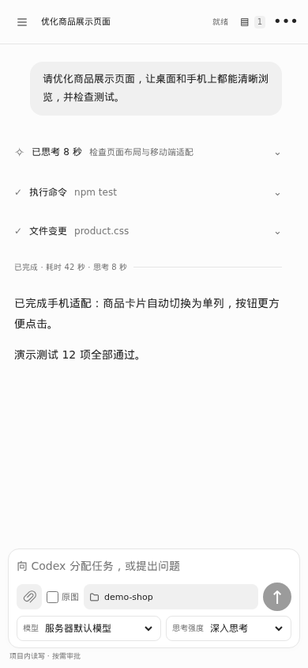
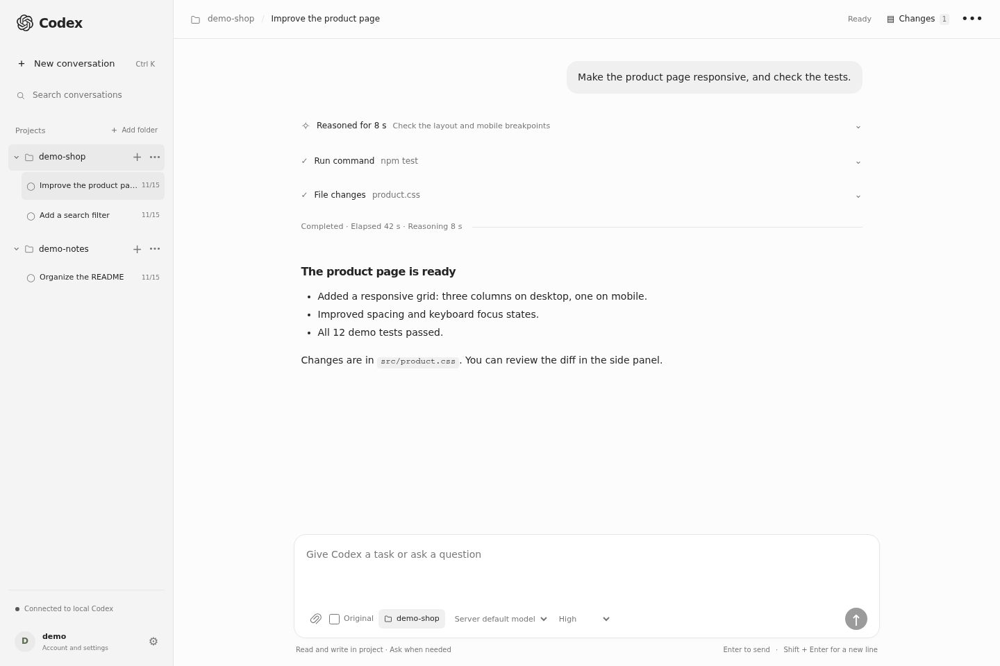

# Codex Web Community

A self-hosted browser workspace for a locally installed Codex CLI on Linux.
Use your own Codex account or model provider to work on your projects from a desktop or phone.
This independent community project is not an official OpenAI client.

[简体中文](../README.md) | English · [Docker](DOCKER.md) · [Deployment](DEPLOYMENT.md) · [Security](../SECURITY.md) · [Contributing](../CONTRIBUTING.md)

## Screenshots

These screenshots use fictional accounts, projects and conversations. They contain no real user content or model provider configuration.

**Desktop · light** — Saved projects, reasoning duration, command output and conversation.



**Desktop · dark** — Review file changes alongside the conversation.



**Mobile** — A compact composer with model and reasoning controls.



**English interface** — Switch languages in settings.



## Configure Codex before using the website

**Configure Codex CLI and verify it works before using the website.** For native deployment, install it on the same Linux server,
under the same user account that will run the web service. The Docker image includes the CLI; authenticate/configure it inside the container.
Complete your Codex sign-in or supported
model provider configuration, and verify that you can run `codex` in the terminal and receive a reply.
Installing Codex only on your computer does not configure a separate web server.
The web interface uses that server's Codex configuration; creating a web administrator account does
not authenticate Codex or provide model access. If Codex is already working, you can proceed to the
web installation steps below.

## Features

- Streaming conversations, tool output, command approvals, file changes and task cancellation.
- Saved project folders, persistent conversation history and paginated long conversations.
- Images via file selection, paste or drop, native vision input and upload progress.
- Document attachments: text/code, CSV/JSON, PDF, DOCX, XLSX, PPTX and readable ZIP contents.
- Scanned PDF pages supplied as images; previews, downloads and explicit extraction limits.
- Remembered login, light/dark/system themes, compact mobile composer and themed loading screen.
- Chinese/English interface with a language picker on the sign-in page and in settings; selection is remembered in each browser.
- Installed plugin and skill management, persistent enable/disable switches and native skill selection for conversations.
- Python backend, SQLite storage and plain HTML/CSS/JavaScript; no frontend build step.

## Requirements

| Component | Requirement |
| --- | --- |
| OS | Linux; Ubuntu 24.04 LTS recommended |
| Python | 3.9+; 3.11/3.12 recommended |
| Codex | Installed CLI with `app-server --stdio`; validated here with 0.159.2 |
| Model access | Your own working Codex login/provider configuration and network access |
| Hardware | Suggested starting point: 2 CPU cores, 4 GB RAM, 20 GB free disk; more for builds |
| GPU | Not required when using a remote model |

Node.js is needed if you install Codex using npm; it is not a runtime dependency of this web application.
Use a supported Node.js LTS release (22 or newer recommended) for that installation method.
Project build/test tools must also be installed on the server as needed.
The server needs outbound HTTPS access to GitHub, the package registries and your model provider;
the browser needs access to your web server.

## Download

Run as your normal Linux user, in the directory where you keep your projects:

```sh
sudo apt update
sudo apt install git python3 python3-venv
git clone https://github.com/luxunhe-wq/codex-web.git codex-web
cd codex-web
```

Alternatively, [download the main-branch ZIP](https://github.com/luxunhe-wq/codex-web/archive/refs/heads/main.zip)
and extract it. Git checkout is recommended for later updates.

## Install and configure Codex

These are native installation steps. Docker users can skip host Python/Codex installation and follow the Docker section below.

If Codex is already working under your Linux account, skip installation. Otherwise install Node.js
LTS and npm first, then install the CLI into a user-owned directory:

```sh
node --version
npm --version
npm install -g --prefix "$HOME/.local" @openai/codex
export PATH="$HOME/.local/bin:$PATH"
codex --version
codex login
codex login status
```

Keep `$HOME/.local/bin` on your shell PATH for future sessions. On a server without a browser,
use `codex login --device-auth` if available for your account, and finish the prompted steps on
another device. Alternatively, use your own supported provider configuration. Verify `codex`
works in the terminal before installing the web service. The web administrator password is separate
from Codex authentication. Refer to the [official CLI documentation](https://developers.openai.com/codex/cli/)
for current installation and authentication options; CLI flags here were checked with 0.159.2.

## Docker quick start

On a Linux server with Docker Engine and Compose v2, run one command in the checkout:

```sh
bash deploy.sh --en
```

The wizard prepares configuration, builds the image, guides you through entering your own API credentials
(with the key hidden), signing in to Codex or importing existing configuration, then creates the web
account and starts the service. Rerunning preserves configuration, accounts and data. Send a test message
in the website to verify your model connection.

```sh
bash deploy.sh status --en
bash deploy.sh stop --en
bash deploy.sh --en
bash deploy.sh configure --en
bash deploy.sh logs --en
```

Use `bash deploy.sh --en --mirror` for alternate download sources if the first build has network problems.
Open `http://127.0.0.1:8080`. See [Docker deployment](DOCKER.md) for remote access, host project mounts,
HTTPS, backup and upgrades. Docker users do not need the native steps below.

From a fresh terminal with Git, Docker and Compose installed, paste:

```sh
git clone https://github.com/luxunhe-wq/codex-web.git codex-web && cd codex-web && bash deploy.sh --en
```

## Which username and password do I use?

**There is no default administrator username or password. Sign in using the web credentials you set during deployment.**

- Guided Docker deployment: on the first run of `bash deploy.sh --en`, the terminal asks you to create the web account after configuring Codex.
- Native deployment: create the web account when running `.venv/bin/python server.py --init-admin`.

| Terminal prompt | What to enter |
| --- | --- |
| `Administrator username:` | Your chosen username, 3–40 characters: letters, numbers, Chinese characters or `. @ _ -` |
| `Password (at least 10 characters):` | Your chosen password, 10–256 characters; no characters appear while typing |
| `Confirm password:` | Enter the same password again |

`Administrator created. Start the service and sign in.` confirms the account was created.
After deployment, open the address printed by the script (default: `http://127.0.0.1:8080`)
and sign in with those credentials. Keep them in a safe place. The `demo` account in screenshots
is fictional and cannot be used to sign in to your deployment.

The web account is separate from Codex sign-in and model API keys. Rerunning the deployment script,
restarting or performing a normal upgrade preserves the existing account. Once signed in,
change credentials under **Account and settings → Account and security**.

## Native quick start

For persistent plugin/skill switches and selecting a skill in a conversation, see [Plugins and skills](PLUGINS.md).

After downloading the repository and configuring Codex, run these commands inside `codex-web`:

```sh
# Prepare the Python environment and literal .env configuration.
python3 scripts/install.py --no-service

# Create the administrator locally; passwords are prompted and never passed in arguments.
.venv/bin/python server.py --init-admin

# Check local runtime dependencies, then start.
.venv/bin/python server.py --check
.venv/bin/python server.py
```

Open `http://127.0.0.1:8080`. For a remote server, use an SSH tunnel:

```sh
ssh -N -L 8080:127.0.0.1:8080 your-user@your-server
```

Install the user service with `python3 scripts/install.py`. For access from a phone or the public Internet,
follow the [HTTPS deployment instructions](DEPLOYMENT.md). The installer does not overwrite your
existing `.env` or interrupt an already-running user service.

New databases default to `workspace-write` and `on-request` approval. Existing saved settings are retained.
This is a single-administrator tool. Logged-in users can change execution permissions; it is not a shared
hosting system with isolation between different users or tenants.

## Interface language

Choose **简体中文** or **English** on the sign-in page, or open **Account and settings → Preferences → Language**
after signing in. Switching applies immediately and keeps your draft, attachments and active conversation.
Your browser remembers the selection, including on the refresh/loading screen. Conversation content,
project names, file contents and model-provided tool descriptions keep their original language.
The default is Simplified Chinese; language preferences are stored per browser, separately from account settings.

## Configuration

Copy `.env.example` to `.env` for manual installation. The server reads it on startup;
`--env-file /absolute/path/to/config.env` selects another file. Values are literal, without shell expansion.
Existing environment variables override file values; CLI host/port options override both.

| Variable | Default / purpose |
| --- | --- |
| `CODEX_WEB_HOST` | `127.0.0.1` |
| `CODEX_WEB_PORT` | `8080` |
| `CODEX_WEB_DATA` | `data/` beside `server.py`; account database and attachments |
| `CODEX_WEB_CWD` | Repository directory; initial project for a new database |
| `CODEX_WEB_CODEX_BIN` | `codex` on PATH, or absolute executable path |
| `CODEX_HOME` | Codex's own default; optional alternate configuration/history directory |
| `CODEX_WEB_ALLOWED_HOSTS` | Comma-separated reverse proxy hostnames, without ports |
| `CODEX_WEB_SECURE_COOKIE` | `0`; set `1` with HTTPS reverse proxy |

Own credentials, account databases and uploads stay on your server and are excluded from Git.
The repository does not include model subscriptions or quota. Connection uses a local
`codex app-server --stdio` process and JSON-RPC; browser updates use SSE.
See the [official CLI documentation](https://developers.openai.com/codex/cli/) and
[App Server documentation](https://developers.openai.com/codex/app-server/) for upstream information.
The validated CLI version above is an observed compatibility baseline, not a minimum-version guarantee.

## Tests

```sh
.venv/bin/python -m unittest discover -s tests -v
.venv/bin/python -m pip install -r requirements-dev.txt
.venv/bin/python -m playwright install chromium
.venv/bin/python tests/browser_workspace.py
.venv/bin/python tests/browser_login_restore.py
.venv/bin/python tests/browser_images.py
.venv/bin/python tests/browser_upload_recovery.py
.venv/bin/python tests/browser_extensions.py
.venv/bin/python tests/browser_files.py
```

Simulated tests use temporary accounts/databases and do not call a model. Set `CHROMIUM_PATH` only
when using your own Chromium. `tests/smoke_*.py` are opt-in real-model checks and may incur usage.
GitHub Actions checks backend tests on Python 3.9/3.11/3.12 and selected browser regressions on Linux.

## License

[AGPL-3.0-only](../LICENSE). See [third-party notices](../THIRD_PARTY_NOTICES.md), including PyMuPDF/MuPDF.
Modified network-served versions must comply with the license's corresponding-source obligations.
